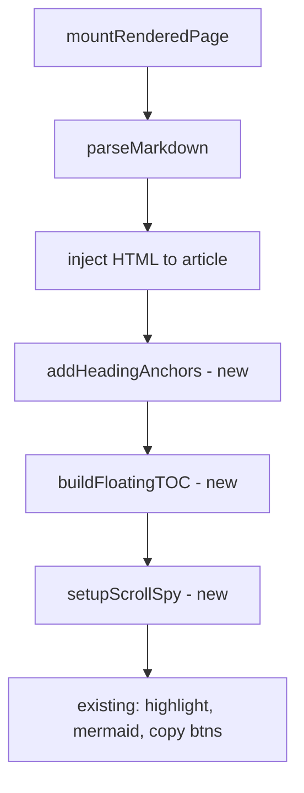

# MD Renderer: Anchor Links & Floating TOC Navigator

## Requirement

1. **Anchor link scroll-to**: Heading elements get slug-based `id` attributes. Clicking `#slug` links smooth-scrolls to the target heading, offset by the fixed source bar height (36px).

2. **Floating TOC navigator**: A sidebar generated from all headings (`h1`-`h6`) in the rendered document.
   - Opacity `0.35` khi mouse out
   - Opacity `0.95` khi hover (not 100%)
   - Fixed position, không che nội dung chính

## Implementation Plan

### Step 1: Heading Anchor IDs

`marked` lib (v9.x) tự generate `id` cho headings. Cần verify và ensure:
- Mỗi heading có `id` dạng slug (e.g. `my-heading`)
- Thêm clickable anchor icon (giống GitHub) bên cạnh heading
- Smooth scroll khi click internal `#` links, compensate cho fixed top bar 36px

### Step 2: Floating TOC Navigator

- Build TOC từ `article.querySelectorAll('h1,h2,h3,h4,h5,h6')`
- Render dạng nested list theo heading level
- Fixed position right side
- Opacity transition: `0.35` → `0.95` on hover
- Click item → smooth scroll to heading
- Highlight active heading khi scroll (Intersection Observer)
- Collapse/hide trên mobile (< 1200px viewport width)
- Ẩn khi đang ở raw view mode

### Step 3: CSS Injection

Thêm styles cho:
- `.md-toc-nav` container
- `.md-toc-nav:hover` opacity
- Heading anchor links styling
- Active heading highlight trong TOC
- Responsive hide

## Files Changed

- `scripts/md-renderer.user.js` — thêm 3 functions mới + styles + integration vào orchestrator
